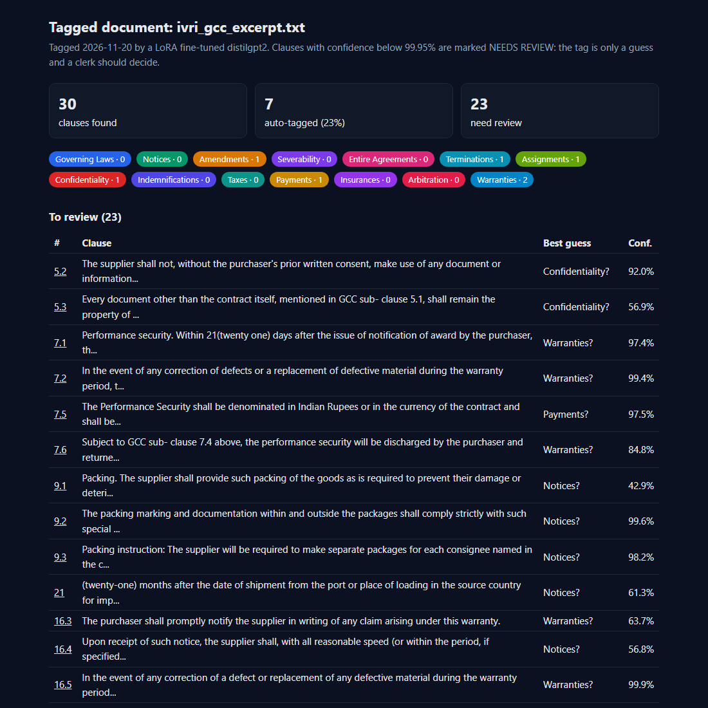
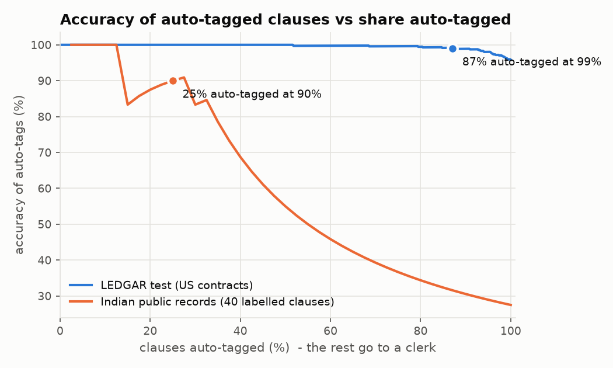
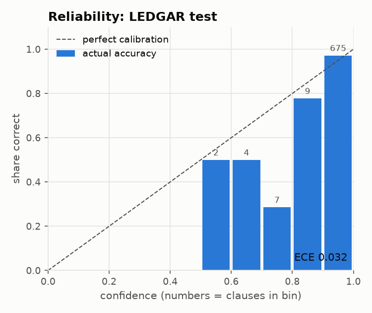
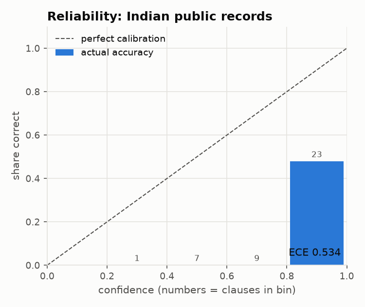

# Legal Document LoRA Tagger

[](https://ask.thili.ai/b/nwzyej8pnw)
[](https://github.com/Sky00raider/legal-document-lora-tagger/actions/workflows/ci.yml)

A tool a public-sector clerk could actually use: give it a contract or tender (.txt or .pdf), and it
splits the document into clauses, tags each clause with its type, and says how sure it is. Clauses
it is unsure about are marked **NEEDS REVIEW** instead of being guessed. Under the hood: distilgpt2
fine-tuned with a hand-written LoRA adapter (0.19% of the weights, a 600 KB file), trained on a
laptop CPU.

> **Headline.** On held-out LEDGAR contract clauses (14 types) the tagger is **95.8% accurate**; at its
> review threshold it **auto-tags 87% of clauses at 99.0% accuracy** and sends 13% to a clerk.
> On **real Indian public records** (government tenders and contract conditions) it **auto-tags 25% of
> clauses at 90% accuracy, sends 75% to a clerk, and flags 96% of the clauses it has no label for**.
> Getting there took a stricter threshold than LEDGAR alone suggests: the model is confidently wrong
> on unfamiliar text. See [what happened on real records](#what-happened-on-real-indian-records).



_The HTML report for [samples/ivri_gcc_excerpt.txt](samples/ivri_gcc_excerpt.txt): 30 real clauses, 7 auto-tagged, 23 sent to a clerk with the model's best guess and confidence._

## Quickstart (no training needed, under a minute)

```bash
python -m venv .venv && source .venv/bin/activate        # Windows: .venv\Scripts\activate
pip install -r requirements.txt
python -m app.cli tag samples/ivri_gcc_excerpt.txt
```

This writes `samples/ivri_gcc_excerpt.tagged.html` (open in a browser), `.md` and `.json`. Any `.txt`
or `.pdf` works: `python -m app.cli tag path/to/tender.pdf`. The trained adapter is in the repo
(`models/adapter.pt`); the first run downloads distilgpt2 (~330 MB) from Hugging Face.

Example outputs, already generated: [samples/](samples/) (open
[`ivri_gcc_excerpt.tagged.md`](samples/ivri_gcc_excerpt.tagged.md) on GitHub, or download an `.html`).

## How it works

1. **Data** ([app/data.py](app/data.py)): LEDGAR clauses (US SEC contracts, 100 clause types), a
   balanced subset of chosen types, 100 per class, each written as `clause text <label>`. Repeated
   clauses are removed and no test clause appears in training.
2. **Label tokens** ([app/model.py](app/model.py)): one new atomic token per clause type
   (`<governing_laws>`, ...), resized embeddings, `pad = eos`. Each new row starts as the average
   embedding of the label's name.
3. **LoRA by hand** ([app/lora.py](app/lora.py)): `LoRALinear` wraps each attention `c_attn`
   (GPT-2's `Conv1D`): output = frozen base + (alpha/r) * x A^T B^T, A random * 0.01, B zero, r=8,
   alpha=16. Everything else is frozen; only A, B and the new label rows learn.
4. **Training** ([app/train.py](app/train.py)): Hugging Face Trainer, lr 1e-3, 6 epochs, CPU. The
   loss is masked to the label position only (-100 everywhere else): the model learns to name the
   clause type, not to write contracts.
5. **Save / merge / infer** ([app/adapter.py](app/adapter.py), [app/tagger.py](app/tagger.py)):
   the adapter file holds only A/B and the label rows. At inference it is merged into the weights
   (W' = W + scale * B@A, transposed for Conv1D) and one forward pass scores the label tokens only:
   argmax = tag, softmax over label tokens = confidence.
6. **Triage** ([app/calibrate.py](app/calibrate.py)): the review threshold is the lowest confidence
   at which auto-tagged LEDGAR *validation* clauses are 98% accurate. It is stored in the adapter.
7. **Documents** ([app/split.py](app/split.py), [app/report.py](app/report.py)): PDF text is split
   at clause numbers (`7.1`, `5.7.2`, `xi.`); page numbers, headers and tables of contents are
   dropped; stand-alone headings are attached to their clause. The report is a single
   self-contained HTML file (no scripts, no internet), plus Markdown and JSON.

## Milestones

- [x] **1. Prepare a dataset of legal clauses**: [app/data.py](app/data.py), `python -m app.cli prepare`
- [x] **2. Extend the GPT-2 tokenizer and model for custom tags**: [app/model.py](app/model.py), `tokens` ([output](outputs/top6/milestone2.txt))
- [x] **3. Implement LoRA and inject it into GPT-2**: [app/lora.py](app/lora.py), `inject` ([output](outputs/top6/milestone3.txt)): 147,456 trainable of 82M (0.180%)
- [x] **4. Fine-tune GPT-2 with LoRA**: [app/train.py](app/train.py), `train` ([output](outputs/top6/milestone4.txt)): adapter saved, reloaded onto a fresh base, same accuracy
- [x] **5. Merge the adapter and tag new clauses**: [app/tagger.py](app/tagger.py), `merge` ([output](outputs/top6/milestone5.txt)): merged scores equal unmerged (max difference 5e-5)
- [x] **6. Evaluate accuracy and efficiency**: [app/evaluate.py](app/evaluate.py), `evaluate` ([results](outputs/top6/results_ledgar.md))

Milestone functions live in [app/core.py](app/core.py); each milestone is one commit.

## Results

Two label sets, same recipe:

- **top6** (the course recipe): LEDGAR's six most common clause types.
- **procurement** (the shipped adapter): 14 types chosen *after reading the Indian documents*.
  LEDGAR's top six are US boilerplate (Counterparts never appears in the Indian documents), while
  payment, tax, termination, arbitration, warranty and insurance clauses are everywhere. Keyword
  counts over 1,856 clauses from the four documents: Payments 147, Taxes 103, Terminations 85,
  Arbitration 81, Warranties 72, Assignments 59 ... Counterparts 0.

### LEDGAR test set (held out)

| | top6 | procurement |
|---|---:|---:|
| Clause types | 6 | 14 |
| Test clauses | 300 | 697 |
| Accuracy | 97.0% | 95.8% |
| Macro-F1 | 97.0% | 95.8% |
| Review threshold (target accuracy on LEDGAR validation) | 0.69 (95%) | 0.9995 (98%) |
| Auto-tagged at that threshold | 99% at 97.3% | 87% at 99.0% |
| Calibration error (ECE) | 0.025 | 0.032 |

Per-class precision/recall/F1 and the most confused pairs: [top6](outputs/top6/results_ledgar.md),
[procurement](outputs/procurement/results_ledgar.md).

### Efficiency: why LoRA

| | top6 | procurement |
|---|---:|---:|
| Parameters in distilgpt2 | 82.1M | 82.1M |
| Trainable (LoRA A/B + label rows) | 152,064 (0.19%) | 158,208 (0.19%) |
| File to ship | 599 KB | 623 KB |
| Full fine-tuned model (float32) | 313 MB | 313 MB |
| Training time, laptop CPU, 6 epochs | 37.8 min (600 clauses) | 84 min (1,400 clauses) |

The adapter is reloaded onto a fresh distilgpt2 after training and gives the same validation
accuracy (top6 99.0%, procurement 95.57% = 669/700; the procurement log prints "MISMATCH" because of
a rounding bug in that check, since fixed).

### Clerk triage and calibration



| Reliability on LEDGAR test | Reliability on real records |
|---|---|
|  |  |

**Picking the threshold.** It is chosen on LEDGAR *validation* only, as the lowest confidence
whose auto-tagged clauses reach a target accuracy, then applied unchanged everywhere else. With a
95% target the procurement threshold came out at 0.42: on LEDGAR the model is that good, so it
auto-tagged everything, and on the Indian records it then auto-tagged 98% of clauses at 28% accuracy,
flagging only 4% of the out-of-set ones. A clerk tool should be conservative, so the target was raised
to 98% (threshold 0.9995). To be transparent: that decision was prompted by the real-record results,
so the real-record numbers at 0.9995 are slightly optimistic; the threshold itself was still fitted on
LEDGAR validation only.

| Procurement adapter, threshold | LEDGAR test: auto-tagged at accuracy | Real records: auto-tagged at accuracy | Real "Other" flagged |
|---|---:|---:|---:|
| 0.42 (95% target) | 100% at 95.8% | 98% at 28% | 4% |
| 0.9995 (98% target, shipped) | 87% at 99.0% | 25% at 90% | 96% |
| higher still (99% target) | 78% at 99.6% | 18% at 86% | 96% |

On LEDGAR the confidences are well calibrated (ECE 0.032). On the real records they are not: 29 of
the 40 best guesses are wrong (25 clauses have no correct label to give), yet 39 of 40 get confidence
above 0.42, and 7 of the wrong ones are above 0.9. Full tables at several thresholds:
[calibration.json](outputs/procurement/calibration.json).

## What happened on real Indian records

**Documents** ([data/real_docs/](data/real_docs/SOURCES.md)): the Government e-Marketplace (GeM)
General Terms and Conditions, ICAR-IVRI's General Conditions of Contract, a 152-page India
Meteorological Department tender, and the Finance Ministry's Model Tender Document for goods
(not committed, 51 MB). 1,856 clauses after splitting.

**Labels**: 40 clauses, half picked because their wording hints at a known clause type, half at
random, each labelled with one of the 14 types or **Other**. The labels are **drafts that have not
yet been reviewed by a person** (`"source": "draft"` in
[hand_labels.json](data/real_docs/hand_labels.json); `python -m app.cli label --review` confirms
or changes them). They were written before the model was run on these clauses.

| On the 40 real clauses | top6 | procurement |
|---|---:|---:|
| Clauses whose type is in the label set | 5 | 15 |
| In-set accuracy (best guess) | 60% | 73% |
| Other clauses flagged NEEDS REVIEW | 14% | 96% |
| **Clerk view: auto-tagged, and their accuracy** | **85% at 8.8%** | **25% at 90%** |

Findings:

1. **The confidence threshold does not transfer.** With six US-boilerplate types, the model
   tagged 85% of Indian clauses with high confidence and was right 8.8% of the time:
   "Transit insurance shall be arranged by Nalco" became Notices at 1.00. A softmax over six labels
   must put its mass somewhere, and on unfamiliar text it often puts all of it on one label.
   Calibrated on LEDGAR, it was confidently wrong on Indian records.
2. **Choosing clause types from the real documents helped.** The procurement label set covers 15
   of the 40 sampled clauses instead of 5, in-set accuracy rose from 60% to 73%, and the share of
   correct auto-tags rose from 8.8% to 28% at the lax threshold.
3. **A strict threshold makes it usable.** At 0.9995 it auto-tags a quarter of real clauses, 9 of 10
   correctly, and flags 24 of the 25 clauses outside its label set (96%). The one confident "mistake"
   is the clause where the PDF splitter merged "Language of Contract" with "2.2 The Entire
   Agreement": the model said Entire Agreements, which is arguably right. Typical misses it does
   *not* catch: performance-security clauses (an Indian procurement concept absent from LEDGAR) tagged
   as Amendments or Payments at 1.00, see clauses 7.3 and 7.4 in
   [the sample](samples/ivri_gcc_excerpt.tagged.md).
4. **Splitting is part of the problem.** Of the 40 sampled clauses, 6 were not clauses at all
   (OCR garbage from scanned pages of the Model Tender Document, a table of contents, form fields,
   tables) and one was two clauses merged because the PDF lost a space ("2.2The Entire Agreement").

## Limitations

- Trained on US SEC contracts (LEDGAR); Indian procurement documents use clause types
  (performance security, liquidated damages, force majeure, integrity pacts) that are not in LEDGAR
  at all, so they can only ever be "Other". The tagger cannot say "none of these"; low confidence is
  its only way to refuse, and on unfamiliar text it is often not low enough.
- One label per clause. Real clauses often mix topics (governing law + jurisdiction + notices).
- 40 evaluation clauses, labelled once, not yet reviewed: the real-record numbers are indicative,
  with wide error bars.
- Scanned PDFs need OCR first; the splitter relies on clause numbering and will merge or cut
  clauses in unusual layouts.
- distilgpt2 reads at most 256 tokens of each clause (the beginning, where the heading usually is).

## Rebuild everything

```bash
python -m app.cli prepare  --run procurement      # milestone 1 (downloads LEDGAR)
python -m app.cli tokens   --run procurement      # milestone 2
python -m app.cli inject   --run procurement      # milestone 3
python -m app.cli train    --run procurement      # milestone 4 (~84 min on a laptop CPU)
python -m app.cli merge    --run procurement      # milestone 5
python -m app.cli evaluate --run procurement      # milestone 6
python -m app.cli calibrate --run procurement     # threshold, plots (stored in the adapter)
python -m app.cli real-eval --run procurement     # the 40 labelled Indian clauses
python -m app.cli label [--review]                # label more clauses / review the drafts
```

`--run top6` reproduces the course-recipe run. Tests: `pytest` (fast, no downloads, runs in CI on
tiny randomly initialised GPT-2 layers); `pytest -m slow` adds the checks that need distilgpt2 and
the trained adapter.

## Project layout

```
app/  data.py model.py lora.py train.py adapter.py tagger.py evaluate.py   # the six milestones
      split.py report.py pipeline.py real.py calibrate.py runs.py metrics.py
      core.py (milestone entry points)  cli.py  storage.py  llm.py (starter, unused)
models/   adapter.pt (procurement, shipped)  adapter_top6.pt
outputs/  top6/ procurement/   results, plots, logs
data/real_docs/   PDFs, SOURCES.md, hand_labels.json
samples/  sample input and tagged outputs
```

## My write-up

**Why this design.** A clerk does not need a model that is right 96% of the time on a benchmark;
they need one that does the easy part and hands them the rest. So every design choice points at
that: one label token per clause type, so the answer is a single forward pass with a real
probability attached; a review threshold instead of a forced answer; and a report a clerk can open
without installing anything. LoRA made it possible to train on my laptop CPU and ship the result
as a 623 KB file instead of a 313 MB model.

**What surprised me.** The model I trained first, on LEDGAR's six most common clause types, scored
97% on held-out clauses and I thought I was done. On real Indian tenders it auto-tagged 85% of
clauses and was right 8.8% of the time, at confidence 1.00. Two fixes helped: picking clause types
by reading the actual documents (Counterparts never appears in an Indian tender, while payment,
tax and arbitration clauses are everywhere), and a much stricter review threshold. Benchmark
accuracy told me almost nothing about how it would behave on the documents it was meant for.

**What I would do next.** Label a few hundred real clauses and fit the threshold on those instead
of on LEDGAR; add the Indian clause types LEDGAR does not have (performance security, liquidated
damages, force majeure) with an explicit "Other" class; and replace the regex clause splitter, which
causes some of the errors on its own.
